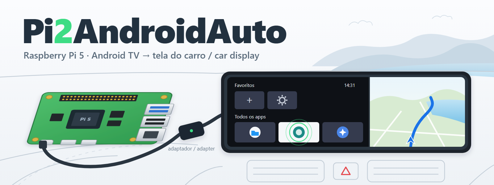

# Pi2AndroidAuto



**[Português](#português) · [English](#english)**

---

## Português

### O que é

O Pi2AndroidAuto transforma um **Raspberry Pi 5 com Android TV** no "celular"
do Android Auto com fio. Ele mostra a tela do Android TV (a mesma imagem que
sai no HDMI) na central multimídia do carro, e os toques nessa tela comandam o
Pi.

É um app Android escrito do zero que faz o papel do **celular** no protocolo
Android Auto (AAP) com fio: TLS, descoberta de serviços, vídeo H.264 e toque.
Projetos abertos que já existiam fazem o outro lado, o do carro (head unit).

```
 Android TV no Pi 5  ──USB-C──►  adaptador Android Auto  ──USB──►  carro
 (HDMI espelhado)                 (ex.: CarlinKit CPC200-CCPA)       (tela e toque)
```

### Situação

| Versão | O que faz | Testado |
|---|---|---|
| **V1** (tag `v1.0`, branch `master`) | Sessão Android Auto completa por USB, tela de teste gerada, toque, 30 fps | **No carro** (Fiat Argo + CPC200-CCPA) |
| **V2** (branch `v2`) | Espelha a tela real do Android TV, injeta os toques do carro, abre itens do launcher da TV com um toque | Banco de testes (carro simulado no PC); falta o carro |

Ainda não tem: áudio de mídia, microfone, sensores e sessão por Wi‑Fi no carro.
É um projeto em fase inicial.

### O que você precisa

- **Raspberry Pi 5** com a build
  [LineageOS 24 Android TV do KonstaKANG](https://konstakang.com/devices/rpi5/LineageOS24-ATV/)
  (userdebug, com `adb root`). Ela já tem o modo gadget USB pelo USB‑C, que é
  o que deixa o Pi agir como celular.
- Um **adaptador Android Auto com fio** que faça o papel do carro para o Pi.
  Testado com o **CarlinKit CPC200‑CCPA (Autokit)**. Ligar o Pi direto num
  carro com Android Auto com fio deve funcionar pelo mesmo caminho, mas ainda
  não foi testado.
- Cabo USB‑C de dados e **alimentação firme** (5 V / 3 A). Porta USB fraca do
  carro ou do PC derruba a sessão.
- Um PC com `adb` e Android SDK (JDK 17) para compilar e instalar.

### Instalar

Ligue o Pi à rede e ative a depuração USB/ADB. Nos exemplos, o Pi está em
`192.168.0.200`.

1. **Compile o app**

   ```bash
   ./gradlew assembleDebug
   ```

2. **Instale tudo com um comando** (app + arquivos de sistema, e reinicia o Pi).
   No Windows, rode no Git Bash:

   ```bash
   tools/pi/install.sh 192.168.0.200
   ```

   O script instala o APK, copia os arquivos de `tools/pi` para o sistema do
   Pi (`/system/etc/init`, `/system/bin`, `/system/usr/idc`), libera a rede
   para o app (`restricted_networking_mode 0`) e reinicia o Pi. Sem endereço,
   ele usa o aparelho que o `adb` já enxerga (USB ou rede).

   No boot, o Pi liga sozinho o ADB por rede (porta 5555), o vigia do USB, o
   servidor de tela (`morozi_screen`) e o serviço de acessibilidade que faz o
   toque abrir itens nos apps feitos só para controle remoto.

   <details><summary>Fazer à mão, sem o script</summary>

   ```bash
   adb connect 192.168.0.200:5555
   adb install -r app/build/outputs/apk/debug/app-debug.apk
   adb root
   adb remount
   adb push tools/pi/morozi.rc /system/etc/init/morozi.rc
   adb push tools/pi/morozi_adbon.sh tools/pi/morozi_aoawatch.sh tools/pi/morozi_screen.sh tools/pi/morozi_usbctl.sh /system/bin/
   adb push tools/pi/Vendor_18d1_Product_7a01.idc /system/usr/idc/
   adb shell chmod 755 /system/bin/morozi_*.sh
   adb shell settings put global restricted_networking_mode 0
   adb reboot
   ```

   </details>

3. **Abra o app uma vez** (ícone "Pi2AndroidAuto" no launcher) para ele
   registrar o acessório USB.

### Usar no carro

1. Ligue o Pi na alimentação e espere o Android TV abrir.
2. Ligue o **USB‑C do Pi** no adaptador Android Auto, e o adaptador no carro.
3. A tela do Android TV aparece na central do carro em alguns segundos.
   Toque na tela do carro para usar o Pi: um toque curto num bloco do launcher
   abre o app, como o OK do controle.

Se a sessão cair, o app tenta de novo sozinho (até 3 vezes) e depois reinicia o
USB.

### Configurar (Wi‑Fi do carro, modo)

Três jeitos, todos gravam as mesmas opções:

- **Tela do app** no Pi.
- **Página web**: `http://<ip-do-pi>:8080`, de qualquer celular ou PC na mesma
  rede. A página também liga um hotspot de configuração do próprio Pi, para
  quando não houver rede.
- **ADB**:

  ```bash
  adb shell am broadcast -a com.morozi.autophone.CONFIGURE -n com.morozi.autophone/.ConfigReceiver --es mode connect --es host 127.0.0.1
  ```

  Opções: `mode` (`listen` ou `connect`), `host`, `port`, `ssid`, `password`
  (Wi‑Fi do carro), `setup_hotspot` (`--ez setup_hotspot true`). A senha
  nunca é mostrada de volta.

### Banco de testes sem carro

`tools/hu/hu.py` faz o papel do carro no PC (USB via WinUSB ou TCP) e imita o
CPC200‑CCPA:

```bash
python tools/hu/hu.py --tcp 192.168.0.200:5277 --ccpa --seconds 12 --tap 220,182
```

Ele mostra o handshake, conta os quadros de vídeo, pode gravar o H.264
(`--dump`) e mandar um toque (`--tap x,y` em coordenadas do vídeo).

### Origem

Escrito do zero. O formato geral do protocolo é público e aparece em todas as
implementações abertas. Comportamentos de adaptadores comerciais foram
observados em testes, sem copiar código de fornecedores nem de projetos com
outras licenças.

---

## English

### What it is

Pi2AndroidAuto turns a **Raspberry Pi 5 running Android TV** into the "phone"
for wired Android Auto. It shows the Android TV screen (the same picture as the
HDMI output) on the car's display, and touches on that display control the Pi.

It is an Android app, written from scratch, that plays the **phone** side of
the wired Android Auto protocol (AAP): TLS, service discovery, H.264 video and
touch. The existing open projects implement the other side, the car (head
unit).

```
 Android TV on Pi 5  ──USB-C──►  Android Auto adapter  ──USB──►  car
 (mirrored HDMI)                  (e.g. CarlinKit CPC200-CCPA)     (display and touch)
```

### Status

| Version | What it does | Tested |
|---|---|---|
| **V1** (tag `v1.0`, branch `master`) | Full Android Auto session over USB, generated test screen, touch, 30 fps | **In a car** (Fiat Argo + CPC200-CCPA) |
| **V2** (branch `v2`) | Mirrors the real Android TV screen, injects the car's touches, opens TV launcher items with a tap | Test bench (simulated car on a PC); not yet in a car |

Not done yet: media audio, microphone, sensors, and a Wi‑Fi session in the
car. This is an early-stage project.

### What you need

- **Raspberry Pi 5** running
  [KonstaKANG's LineageOS 24 Android TV build](https://konstakang.com/devices/rpi5/LineageOS24-ATV/)
  (userdebug, with `adb root`). It already supports USB gadget mode on the
  USB‑C port, which is what lets the Pi act as a phone.
- A **wired Android Auto adapter** that plays the car's role toward the Pi.
  Tested with the **CarlinKit CPC200‑CCPA (Autokit)**. Plugging the Pi
  straight into a car with wired Android Auto should work the same way, but
  it has not been tested.
- A USB‑C data cable and **solid power** (5 V / 3 A). A weak car or PC USB
  port drops the session.
- A PC with `adb` and the Android SDK (JDK 17) to build and install.

### Install

Put the Pi on your network and turn on USB/ADB debugging. The examples use
`192.168.0.200` for the Pi.

1. **Build the app**

   ```bash
   ./gradlew assembleDebug
   ```

2. **Install everything with one command** (app + system files, then the Pi
   reboots). On Windows, run it in Git Bash:

   ```bash
   tools/pi/install.sh 192.168.0.200
   ```

   The script installs the APK, copies the files from `tools/pi` into the
   Pi's system (`/system/etc/init`, `/system/bin`, `/system/usr/idc`), lets the
   app use the network (`restricted_networking_mode 0`) and reboots the Pi.
   Without an address it uses the device `adb` already sees (USB or network).

   At boot the Pi turns on ADB over the network (port 5555), the USB watcher,
   the screen server (`morozi_screen`) and the accessibility service that lets
   a tap open items in apps built for the remote only.

   <details><summary>By hand, without the script</summary>

   ```bash
   adb connect 192.168.0.200:5555
   adb install -r app/build/outputs/apk/debug/app-debug.apk
   adb root
   adb remount
   adb push tools/pi/morozi.rc /system/etc/init/morozi.rc
   adb push tools/pi/morozi_adbon.sh tools/pi/morozi_aoawatch.sh tools/pi/morozi_screen.sh tools/pi/morozi_usbctl.sh /system/bin/
   adb push tools/pi/Vendor_18d1_Product_7a01.idc /system/usr/idc/
   adb shell chmod 755 /system/bin/morozi_*.sh
   adb shell settings put global restricted_networking_mode 0
   adb reboot
   ```

   </details>

3. **Open the app once** ("Pi2AndroidAuto" in the launcher) so it registers
   the USB accessory.

### Use it in the car

1. Power the Pi and wait for Android TV to start.
2. Connect the **Pi's USB‑C port** to the Android Auto adapter, and the
   adapter to the car.
3. The Android TV screen shows up on the car's display within a few seconds.
   Touch the car's display to use the Pi: a short tap on a launcher tile opens
   the app, like the remote's OK button.

If the session drops, the app retries on its own (up to 3 times) and then
resets USB.

### Configure (car Wi‑Fi, mode)

Three ways, all saving the same settings:

- The **app's own screen** on the Pi.
- **Web page**: `http://<pi-ip>:8080` from any phone or PC on the same
  network. The page can also start the Pi's own setup hotspot for when there
  is no network.
- **ADB**:

  ```bash
  adb shell am broadcast -a com.morozi.autophone.CONFIGURE -n com.morozi.autophone/.ConfigReceiver --es mode connect --es host 127.0.0.1
  ```

  Options: `mode` (`listen` or `connect`), `host`, `port`, `ssid`,
  `password` (car Wi‑Fi), `setup_hotspot` (`--ez setup_hotspot true`). The
  password is never shown back.

### Test bench without a car

`tools/hu/hu.py` plays the car on a PC (USB through WinUSB, or TCP) and
behaves like the CPC200‑CCPA:

```bash
python tools/hu/hu.py --tcp 192.168.0.200:5277 --ccpa --seconds 12 --tap 220,182
```

It prints the handshake, counts video frames, can save the H.264 stream
(`--dump`) and can send a touch (`--tap x,y` in video coordinates).

### Provenance

Written from scratch. The protocol's general shape is public and shared by
every open implementation. The behavior of commercial adapters was learned by
observing them in tests, without copying code from vendors or from projects
under other licenses.

### License

TBD.
